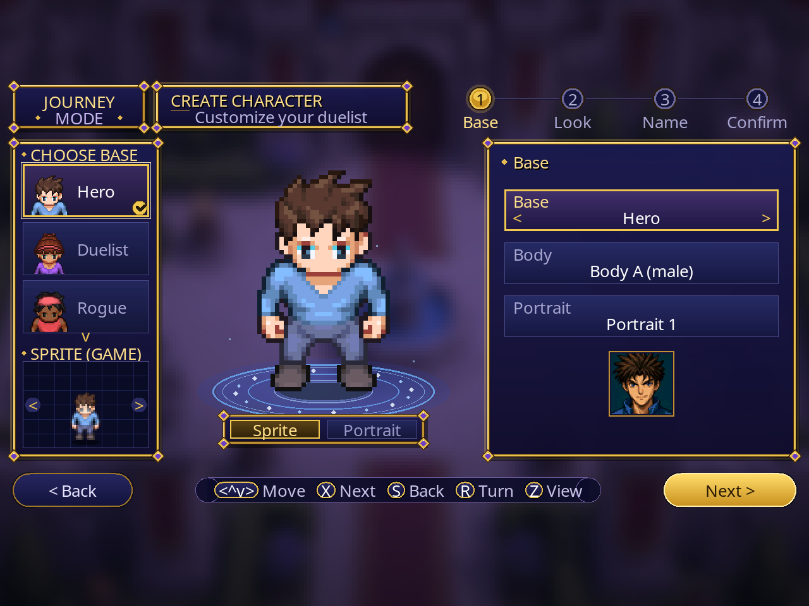
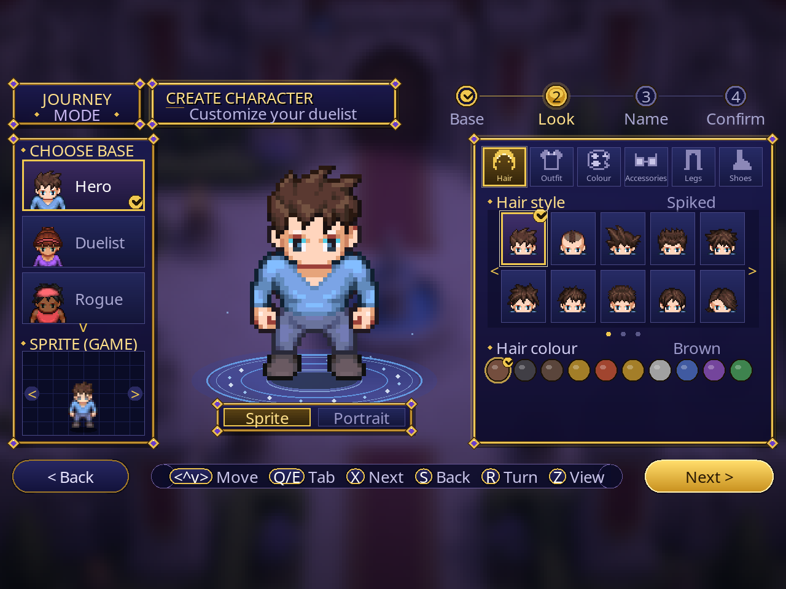
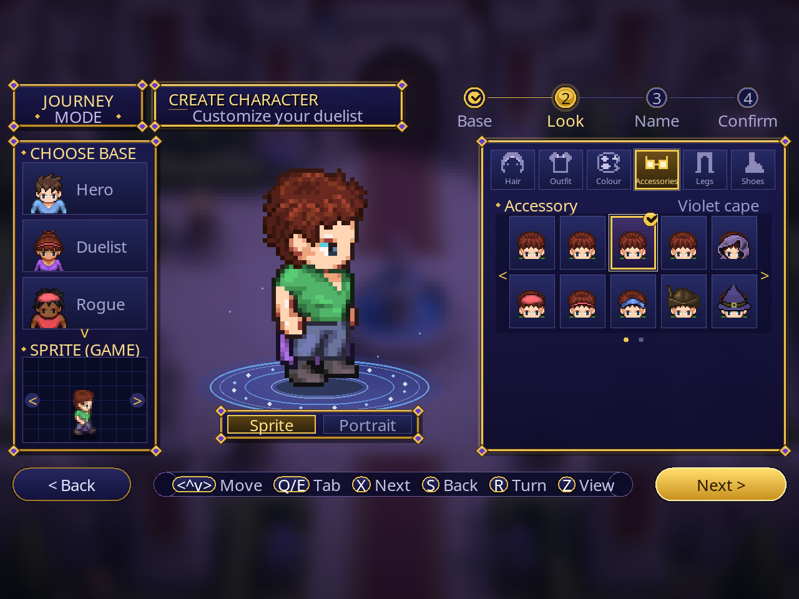
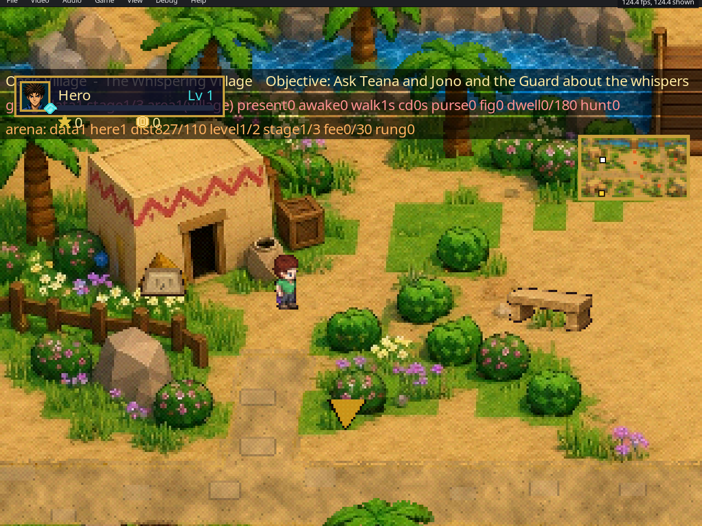

<div align="center">

# ⚔️ Journey Mode
### A story-driven RPG mode for *Yu-Gi-Oh! Forbidden Memories*

Explore illustrated maps, talk to the duelists of Forbidden Memories, take quests and fight real duels with the game's own engine.

[](https://github.com/omagodev/forbidden-memories-journey-mode/releases)
[](LICENSE)


<a href="README.pt-BR.md"></a>


</div>

---

## What is this?

Journey Mode is a fan-made, just-for-fun project. I took the amazing work of the Forbidden Memories community, adapted it, and wanted to build an **RPG story** on top of the game I grew up with.

The core idea: the duelists from the game's memory are **linked directly to NPCs on the map**. You walk up to Simon, Teana, Jono or Rex Raptor in an illustrated village, talk to them, and when a duel starts it is the real Forbidden Memories duel, with the real decks, the real AI and the real fusions.

## Why sprites and not 3D?

My first goal was a game that could still run on a **PlayStation 1**. I started with low-poly 3D maps, but the PS1 graphics engine only handles so many vertices, and the result never looked the way I wanted.

So I switched to **illustrated 2D backgrounds with sprites**. They are far lighter than 3D models, and with a few tricks (layered overlays, swaying palms, animated water and fire, occluders you walk behind) they make the player feel they're in a rich, good-looking map, which the 3D version couldn't deliver with that vertex budget. Today the mode runs on the native PC port, but it keeps that PS1-era spirit.

| | |
|---|---|
|  |  |
| *Quests and objectives in the home town* | *The clandestine underground arena, lit by animated fire* |

## The story

> **The Duelist Kingdom** (work in progress)

You are a young duelist from **Oasis Village**, a sleepy desert town where everyone shuffles cards in the sun. Rumors start spreading about a tournament on a faraway island, a place where duelists wager **star chips** and only the best reach the castle.

* **Chapter 1: Home town.** Prove yourself in Simon's test duel. On a quiet night a hooded stranger hands you a Stamp Card. Earn three stamps through creative quests (something lost, something won, something given), pass the harbor exam and face Shadi's trial. Win the **Star Passage** and your first star, just like Joey did, then say goodbye at the pier.
* **On the ship** you meet Mai, learn the star rules, and run into **InsetoKaiba**: an arrogant, insect-obsessed rival in a white coat with a pompadour, and a parody you won't forget.
* **The Kingdom (chapters 2-10, outlined):** the Shore of Illusions, the Forest of Whispers, the Mountain Pass, the Meadow Maze, the Desert of Lost Stars and the Star Fair. Win stars, lose stars, never get a game over. Reach **10 stars** to open the castle gate and climb to Pegasus's Dream Room.
* **Mago.dev, the observer.** A mage who *programs reality* but never interferes. You'll catch glimpses of him on rooftops, in green glyphs on a cistern wall and at the top of a mast... until the very end.

The full outline is in [`journey_content/duelist_kingdom/`](journey_content/duelist_kingdom/README.md), and every line of dialogue in reading order is in [English](journey_content/duelist_kingdom/en/story_readable_dk.en.md) and [Portuguese](journey_content/duelist_kingdom/pt/story_readable_dk.pt.md). Spoilers, of course.

## Character creator

Before the journey starts you build your own duelist, and the hero you see walking on the map is exactly the one you made, frame by frame (1 idle + 9 walk frames). Every part is a real LPC sprite layer composed at runtime.

| Part | Variations |
|---|---|
| Starting bases | **6**: Hero, Duelist, Rogue, Mystic, Scholar, Ranger |
| Skin tones | **6** |
| Body types | **2** |
| Hair styles | **21**, each in **10** colours |
| Tops / outfits | **11**, each in **10** colours |
| Legs | **10** |
| Shoes | **7** |
| Accessories | **13** (capes, hats, glasses and more) |

That is more than **250 million** possible combinations (6 × 2 × 21 × 10 × 11 × 10 × 10 × 7 × 13). Some examples: pick the **Rogue** base, give him long white hair and a red tunic, and you get a wandering card thief; take the **Mystic**, switch to a dark skin tone, purple hair and a cape, and you have a desert sorcerer; or start from the **Scholar**, add glasses and a green vest for a quiet card researcher.

<div align="center">

**Choose a base**



**Pick a hair style and colour**



**Add accessories**



**Your hero walking in game**



</div>

## Features

- 🗺️ **Illustrated maps:** a home town, a cistern and an underground arena, with animated water, fire and swaying palms
- 🧑‍🤝‍🧑 **NPCs linked to Forbidden Memories duelists:** talk, take quests, and duel them with the original engine
- 🎭 **Character creator:** build your hero from layered parts (body, outfit, hair, accessory)
- 📜 **Quests, objectives and a journal**, with an objective arrow and a mini-map
- 💰 **Economy (early):** money, a shop in every town and card drops from the local card pool only
- 🥷 **Duelist gang (early):** they ambush you at a set frequency, you can't run, and if they win they take your money
- 🔥 **Clandestine arenas (early):** farm local cards and level up
- 🌐 **English and Brazilian Portuguese**

## Play

> 📥 **No compiling needed.** Grab the Windows build from [Releases](https://github.com/omagodev/forbidden-memories-journey-mode/releases/latest). Full guide: [docs/HOW_TO_PLAY.md](docs/HOW_TO_PLAY.md).

1. Download the latest build from [**Releases**](https://github.com/omagodev/forbidden-memories-journey-mode/releases) and extract it.
2. Copy your `.bin` into the `game` folder, then run `JOGAR_JourneyMode.bat` (or `memories-pc.exe`).
3. On first launch, pick **your own** USA disc image (`SLUS-01411`, `.bin`). **No game data is included.**
4. On the title screen, choose **NEW GAME** to create your character.

## Build and contribute

Everything you need to set up, build and test is in [**docs/CONTINUE_DEVELOPMENT.md**](docs/CONTINUE_DEVELOPMENT.md). The short version:

```sh
./build-pc.sh                                         # build the port
python3 tools/pc/build_mod.py --target i386 mods/ow-poc   # build Journey Mode
```

| Folder | What's inside |
|---|---|
| [`mods/ow-poc/`](mods/ow-poc) | The Journey Mode mod: C code, maps and sprites converted for the game, tools |
| [`journey_content/`](journey_content) | Story, decks, economy and UI text (EN/PT) with validators |
| [`art_dk/`](art_dk) | Art sources and bake pipelines |
| [`docs/`](docs) | Hand-off guide, testing and [the native port's docs](docs/PORT.md) |

Ideas, bugs and pull requests are very welcome: see [CONTRIBUTING.md](CONTRIBUTING.md) and the [roadmap](ROADMAP.md).

## Roadmap

The highlights (full list in [ROADMAP.md](ROADMAP.md)):

- [x] Illustrated home town, NPCs, dialogue, quests and chapter 1
- [x] Character creator with layered sprites
- [x] Underground arena with animated fire
- [ ] Economy, gang and arenas: balance and polish
- [ ] Duelist Kingdom chapters 2-10
- [ ] More illustrated areas: harbor, ship and the island zones
- [ ] 🌐 **Online multiplayer**: duel your friends from the map

## Built on the shoulders of giants

This project would not exist without:

- **[Yu-Gi-Oh! Forbidden Memories Recompiled](https://github.com/Unchiga/Yu-Gi-Oh-Forbidden-Memories-Recompiled)** by Unchiga and contributors: the native PC port, renderer and mod loader everything here runs on. Go support them.
- **[memories-decomp](https://github.com/krystalgamer/memories-decomp)** by krystalgamer and its authors: the decompilation behind the port.
- The **[Liberated Pixel Cup](https://github.com/LiberatedPixelCup/Universal-LPC-Spritesheet-Character-Generator)** artists, **Kenney** and **Quaternius**, among others.

The full list, with licenses, is in [CREDITS.md](CREDITS.md).

## License

Journey Mode code and content are [MIT](LICENSE), © Atos Vinicius ([omagodev](https://github.com/omagodev)). The port is MIT by its authors. Third-party art keeps its own license (see [CREDITS.md](CREDITS.md)).

*Yu-Gi-Oh! and Forbidden Memories belong to Kazuki Takahashi and Konami. This is an unofficial, non-commercial fan project and is not affiliated with Konami.*
