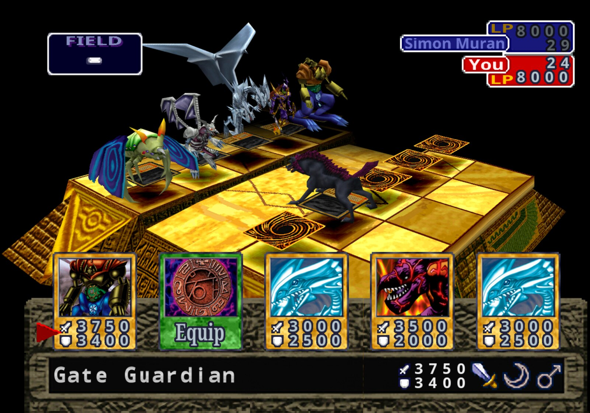
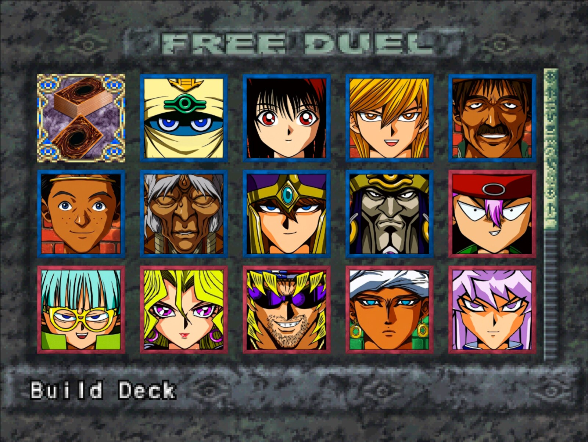

# Journey Mode: Yu-Gi-Oh! Forbidden Memories

A story and open-world mode for **Yu-Gi-Oh! Forbidden Memories**, in English and Portuguese: walk painted maps, talk to duelists, follow a story and fight real duels with the game's own engine. The current story is a Duelist Kingdom adventure that starts in your home town (work in progress, home town arc through part 3; the older eight-chapter story is kept as a backup). Created by Atos Vinicius (omagodev).

Press **JOURNEY MODE** on the title screen. You need your own legal copy of the USA disc (SLUS-01411); no game data is included. The painted maps, sprites and portraits of Journey Mode are original AI-assisted art made for this project (see [CREDITS.md](CREDITS.md)).

## Built on the shoulders of others

This project is built on **[Yu-Gi-Oh! Forbidden Memories Recompiled](https://github.com/Unchiga/Yu-Gi-Oh-Forbidden-Memories-Recompiled)** by Unchiga and contributors, the native PC port that makes all of it possible, which in turn builds on **[memories-decomp](https://github.com/krystalgamer/memories-decomp)** by krystalgamer and its authors. This repository started from a copy of their port and adds Journey Mode on top. Please go and check out and support their project too: it keeps its own community, history, releases and the HD pack. Thank you to everyone there.

## Where things are

* [`docs/CONTINUE_DEVELOPMENT.md`](docs/CONTINUE_DEVELOPMENT.md): hand-off guide (setup, build, tests, next steps).
* `mods/ow-poc/`: the Journey Mode mod (code, baked maps and models, tools).
* `art_dk/`: art sources and bake tools (large raw generations and private references are not included).
* `journey_content/`: story, decks and UI text in English and Portuguese, with validators. The Duelist Kingdom story is in `journey_content/duelist_kingdom/`.
* `mods/ow-poc/tools/`: bake scripts, the fast test helper and the smoke-test scenarios (see `mods/ow-poc/tools/TESTING.md` and `docs/TESTING.md`).
* `notes/journey-mode.md`: design notes. The rest of `notes/` is the port's documentation.
* [CREDITS.md](CREDITS.md): everyone whose work is used here.

## The native port

**Yu-Gi-Oh! Forbidden Memories** (PS1, USA) rebuilt from its decompiled source as a
native PC game for Windows and Linux, with a macOS ARM64 source build. Bring your own disc image; no game data is
included but the text of the European translations (below).

This is not a static recompilation: the game code was decompiled
by hand into C that matches the original byte for byte, then ported to PC.



## Features

- Up to 4x internal resolution, widescreen and HD text
- **3D Monsters**: face-up monsters stand on the field as their battle models
- Optional **Forbidden Memories HD** pack: redrawn cards, frames and portraits
- Mods: framework for new cards past the original 722, fusions, textures, music, gameplay tables
- **FM Editor**: make mods without writing JSON: cards, art, fusions, duelists, decks, packs, the title screen and more ([guide](tools/pc/fm_editor/README.md))
- Save slots, fusion helper, card drop rates, rebindable controls
- **Game > Language**: the European releases' own English, French, German, Italian and Spanish



## Play

Download the latest build from [Releases](https://github.com/omagodev/forbidden-memories-journey-mode/releases),
extract it and run `memories-pc.exe` (Windows) or `./memories-pc` (Linux). On first
launch, pick your USA disc's `.bin`. The game can tell you when a newer release is out
(**Help > Check for updates at start** turns it off; see [Updates](notes/updates.md)).

### Bring your save from an emulator

Your save from the original game (an emulator's memory card, or a PS1 card copied to a PC)
loads in the port. Copy the memory card file (`.mcr`, `.mcd`, `.srm`, `.gme`, `.mcs`, `.psv`,
...; DuckStation keeps its cards in its `memcards` folder, ePSXe in `memcards`) into the
port's `saves` folder: `Documents\My Games\YFM Re-Decomp\saves` on Windows,
`~/.local/share/YFM Re-Decomp/saves` on Linux. Then pick **LOAD** on the title screen: the
save is copied into an empty slot (the card file is renamed `.imported`) and you can load it.
Emulator save states are not memory cards and cannot be imported; save in game first.

### HD pack

1. From the same release, download `yfm-redecomp-hd-mod-<version>.zip`.
2. Close the game and extract the zip into the game folder, the one with `memories-pc.exe`
   or `memories-pc`. You should end up with `mods/assets-hd` beside the other mods.
3. Start the game. The pack is on by default: press **F10** for the menu bar and open
   **Game > Mods** to check it, or to turn it or any of its parts off.
4. For the best look, pick **Video > Resolution > Internal 4x** and turn on **Video > HD text**.

**From source:** put the `.bin` in `game/` and run `play.bat` or `./play.sh`. The first
run builds everything (Linux needs `gcc` and `python3`). See [PC build](notes/pc-build.md).

On Apple Silicon, `./play.sh` builds and runs the macOS target using Python 3,
Xcode command-line tools, and verified dependencies installed under `tmp/`.
See [macOS build](notes/macos-build.md) and the [ARM64 runtime guide](notes/macos-arm64.md).
Native save states use F5/F7 and have build and platform compatibility limits;
see [save-state compatibility](notes/macos-arm64.md#save-state-use-and-compatibility). Code mods
need a macOS ARM64 build; existing i386 code-mod binaries cannot be loaded.
See [macOS code mods](notes/modding.md#native-macos-arm64-code-mods).

**Languages:** `languages/*.txt` is the text of the five European releases, read off the
PAL discs by the port itself. With the discs in `game/pal`, `python3 tools/pc/export_languages.py`
writes them again, and `--check` compares them ([Translations](notes/translation.md),
"The official languages"). They are the only game data in the repository: text, no pictures.

## Decompilation

Every game function matches the original executable byte for byte:

```sh
make tools   # pinned toolchain
make match   # rebuild SLUS_014.11 exactly (see notes/setup.md)
```

<details>
<summary>Progress</summary>

<!-- BEGIN GENERATED PROGRESS -->

| Metric | Current |
|---|---:|
| Game C-decompilation targets matched | **1,134 / 1,134 (100.00%)** |
| Game C-decompilation target bytes matched | **356,080 (`0x56EF0`) / 356,080 (`0x56EF0`) (100.00%)** |
| Remaining game C-decompilation targets | 0 functions, 0 (`0x0`) |
| Evidence-backed handwritten game assembly | 61 functions, 40,116 (`0x9CB4`) |
| Total game-owned functions | 1,195 |
| Preserved Psy-Q CRT/SDK assembly | 591 functions, 117,348 (`0x1CA64`) |
| Total discovered functions | 1,786 |
| Embedded/unassigned resident text | 1,780 (`0x6F4`) |

Runtime overlay modules:

| Module | Matching C functions | Matching C bytes |
|---|---:|---:|
| `free_duel` | 9 / 9 (100.00%) | 4,140 (`0x102C`) / 4,140 (`0x102C`) (100.00%) |
| `main_menu` | 31 / 31 (100.00%) | 17,724 (`0x453C`) / 17,724 (`0x453C`) (100.00%) |
| `overworld_after_coup` | 15 / 15 (100.00%) | 6,184 (`0x1828`) / 6,184 (`0x1828`) (100.00%) |
| `overworld_before_coup` | 15 / 15 (100.00%) | 6,184 (`0x1828`) / 6,184 (`0x1828`) (100.00%) |
| `password` | 27 / 27 (100.00%) | 10,884 (`0x2A84`) / 10,884 (`0x2A84`) (100.00%) |

_Generated from `config/slus_01411/functions.csv` and `config/slus_01411/overlays/*_functions.csv` by `tools/project/progress.py`._

<!-- END GENERATED PROGRESS -->

</details>

## Docs

[Modding](notes/modding.md) · [FM Editor](tools/pc/fm_editor/README.md) · [More cards](notes/more-cards.md) · [Fusion helper](notes/fusion-helper.md) ·
[Card drops](notes/card-drops.md) · [Card packs](notes/card-packs.md) · [Translations](notes/translation.md) · [Updates](notes/updates.md) · [Setup](notes/setup.md) · [Build](notes/build.md) ·
[Releases](notes/pc-release.md)

## Community

Questions, ideas and bug reports: open an [issue](https://github.com/omagodev/forbidden-memories-journey-mode/issues).
The original project has its own community, linked in [its README](https://github.com/Unchiga/Yu-Gi-Oh-Forbidden-Memories-Recompiled#community).

## License and credits

Journey Mode (`mods/ow-poc`, `journey_content/`) is [MIT](LICENSE), copyright Atos Vinicius. The PC port (`src/pc/`, `tools/pc/`, `tests/pc/`, `mods/`, `examples/` and the build and play scripts) is by Unchiga and contributors, also [MIT](LICENSE). The decompilation builds on [memories-decomp](https://github.com/krystalgamer/memories-decomp) by its authors. Yu-Gi-Oh! and Forbidden Memories belong to Konami. Full list in [CREDITS.md](CREDITS.md).
