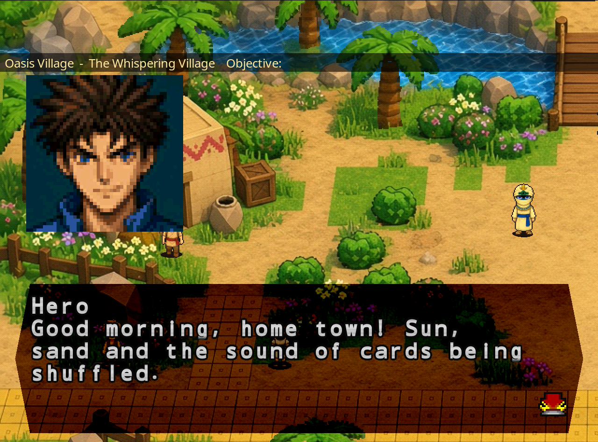
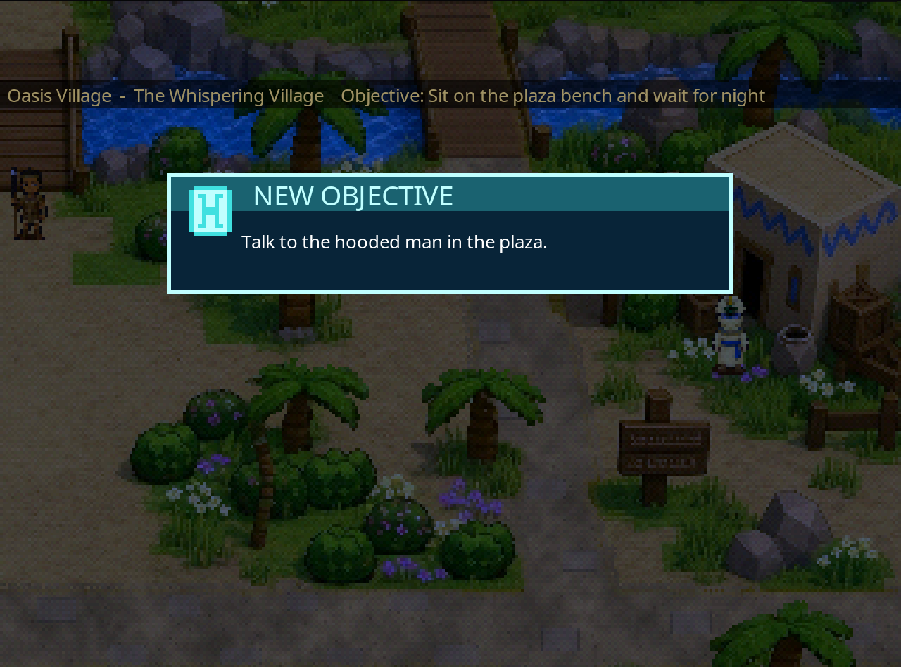
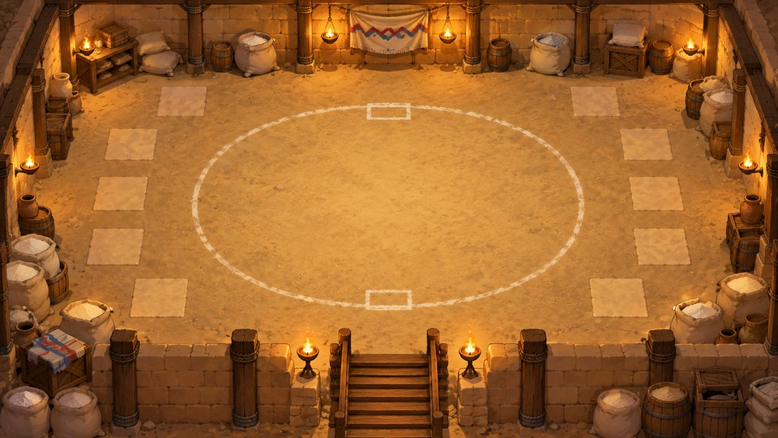
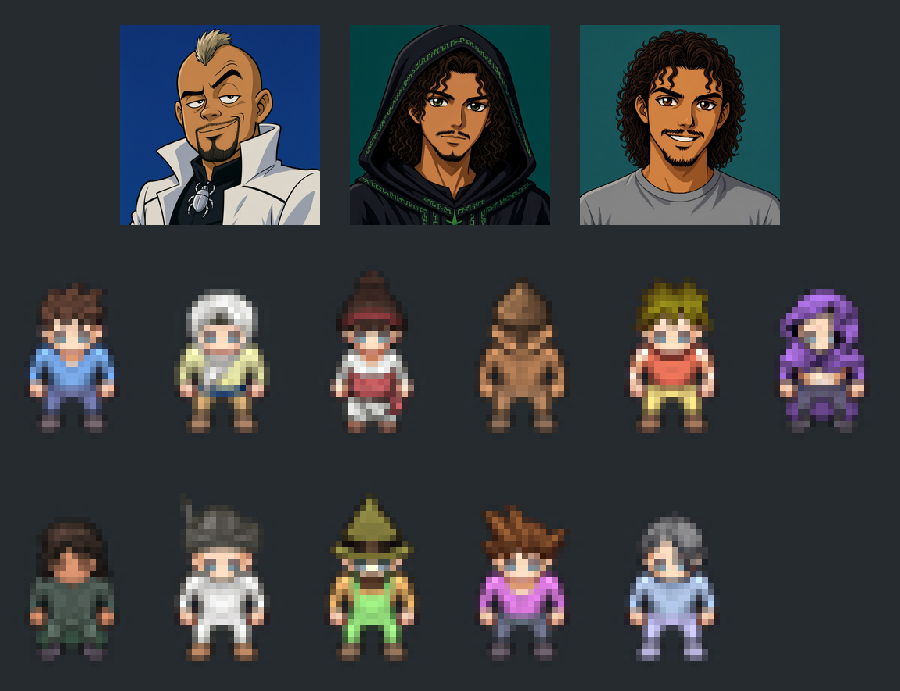

# ⚔️ Journey Mode
### Um modo RPG com história para *Yu-Gi-Oh! Forbidden Memories*

Ande por mapas pintados, converse com os duelistas do Forbidden Memories, faça missões e trave duelos de verdade com o próprio motor do jogo.

[English](README.md) · **Português (BR)**

---

## O que é isso?

O Journey Mode é um projeto de fã, feito por diversão. Peguei o trabalho incrível da comunidade do Forbidden Memories, adaptei e quis criar uma **história de RPG** em cima do jogo com que cresci.

A ideia central: os duelistas da memória do jogo estão **ligados diretamente aos NPCs do mapa**. Você chega no Simon, na Teana, no Jono ou no Rex Raptor numa vila pintada, conversa com eles, e quando o duelo começa é o duelo de verdade do Forbidden Memories, com os decks, a IA e as fusões originais.

## Por que sprites e não 3D?

Meu objetivo inicial era um jogo que ainda rodasse num **PlayStation 1**. Comecei com mapas 3D low-poly, mas o motor gráfico do PS1 aguenta uma quantidade limitada de vértices e o resultado não me agradou.

Então troquei para **fundos 2D pintados com sprites**. Eles são muito mais leves que modelos 3D, e com alguns truques (camadas, palmeiras balançando, água e fogo animados, oclusores que você atravessa por trás) dá pra fazer o jogador sentir que está num mapa bonito e rico, coisa que o 3D não permitia com aquele limite de vértices. Hoje o modo roda no port nativo para PC, mas mantém esse espírito da era PS1.

| | |
|---|---|
|  |  |
| *Missões e objetivos na vila natal* | *A arena clandestina subterrânea, iluminada por fogo animado* |

## A história

> **O Reino dos Duelistas** (em desenvolvimento)

Você é um jovem duelista da **Vila Oásis**, uma cidade tranquila no deserto onde todo mundo embaralha cartas no sol. Começam a surgir boatos sobre um torneio numa ilha distante, onde duelistas apostam **estrelas** e só os melhores chegam ao castelo.

* **Capítulo 1: a vila natal.** Prove seu valor no duelo-teste do Simon. Numa noite silenciosa, um encapuzado te entrega um Cartão de Carimbos. Ganhe três carimbos em missões criativas (algo perdido, algo vencido, algo doado), passe pela prova do porto e encare o desafio de Shadi. Conquiste o **Passe Estelar** e sua primeira estrela, igual ao Joey, e se despeça de todos no cais.
* **No navio** você conhece a Mai, aprende as regras das estrelas e esbarra no **InsetoKaiba**: um rival arrogante e obcecado por insetos, de jaleco branco e topete. Uma paródia inesquecível.
* **O Reino (capítulos 2 a 10, roteirizados):** Costa das Ilusões, Floresta dos Sussurros, Passagem da Montanha, Labirinto da Campina, Deserto das Estrelas Perdidas e Feira das Estrelas. Ganhe e perca estrelas, mas nunca tome game over. Junte **10 estrelas** para abrir o portão do castelo e subir até a Sala dos Sonhos do Pegasus.
* **Mago.dev, o observador.** Um mago que *programa a realidade*, mas nunca interfere. Você vai vê-lo de relance em telhados, em runas verdes na parede de uma cisterna, no alto de um mastro... até o final.

O roteiro completo está em [`journey_content/duelist_kingdom/`](journey_content/duelist_kingdom/README.md), e todos os diálogos em ordem de leitura estão em [português](journey_content/duelist_kingdom/pt/story_readable_dk.pt.md) e [inglês](journey_content/duelist_kingdom/en/story_readable_dk.en.md). Com spoilers, claro.

## Personagens

*Em cima: InsetoKaiba e Mago.dev (manto e camiseta). Embaixo, os sprites do jogo: herói (teste), Simon, Teana, o guarda, Jono, o rival, Mago.dev, o padeiro, o fazendeiro, Rex Raptor e Bakura.*

## Funcionalidades

- 🗺️ **Mapas pintados:** vila natal, cisterna e arena subterrânea, com água, fogo e palmeiras animados
- 🧑‍🤝‍🧑 **NPCs ligados aos duelistas do Forbidden Memories:** converse, faça missões e duele com o motor original
- 🎭 **Criador de personagem** montado em camadas (corpo, roupa, cabelo, acessório)
- 📜 **Missões, objetivos e diário**, com seta de objetivo e minimapa
- 💰 **Economia (inicial):** dinheiro, uma loja em cada cidade e drop só das cartas locais
- 🥷 **Gangue de duelistas (inicial):** te abordam com uma certa frequência, você não pode fugir, e se eles ganham levam seu dinheiro
- 🔥 **Arenas clandestinas (inicial):** farme cartas locais e suba de nível
- 🌐 **Inglês e português**
- 🛠️ **Modo dev** e cenários de teste rápido que pulam direto para qualquer ponto da história

## Como jogar

> 📥 **Não precisa compilar.** Baixe a versão para Windows em [Releases](https://github.com/omagodev/forbidden-memories-journey-mode/releases/latest). Guia completo: [docs/HOW_TO_PLAY.md](docs/HOW_TO_PLAY.md).

1. Baixe a versão mais recente em [**Releases**](https://github.com/omagodev/forbidden-memories-journey-mode/releases) e extraia.
2. Rode `JOGAR_JourneyMode.bat` (ou `memories-pc.exe`).
3. Na primeira vez, escolha **a sua própria** imagem do disco americano (`SLUS-01411`, `.bin`). **Nenhum dado do jogo vem incluso.**
4. Na tela de título, escolha **NOVO JOGO** para criar seu personagem.

## Compilar e contribuir

O guia completo de configuração, compilação e testes está em [**docs/CONTINUE_DEVELOPMENT.md**](docs/CONTINUE_DEVELOPMENT.md). Ideias, bugs e pull requests são muito bem-vindos: veja o [CONTRIBUTING.md](CONTRIBUTING.md) e o [roadmap](ROADMAP.md), que inclui o **multiplayer online** como uma das próximas grandes features.

## Créditos

Construído sobre o **[Yu-Gi-Oh! Forbidden Memories Recompiled](https://github.com/Unchiga/Yu-Gi-Oh-Forbidden-Memories-Recompiled)** (Unchiga e colaboradores) e o **[memories-decomp](https://github.com/krystalgamer/memories-decomp)** (krystalgamer e autores). A lista completa está em [CREDITS.md](CREDITS.md).

Código e conteúdo do Journey Mode sob licença [MIT](LICENSE), © Atos Vinicius ([omagodev](https://github.com/omagodev)). *Yu-Gi-Oh! e Forbidden Memories pertencem a Kazuki Takahashi e à Konami. Projeto de fã, não oficial e sem fins comerciais.*
