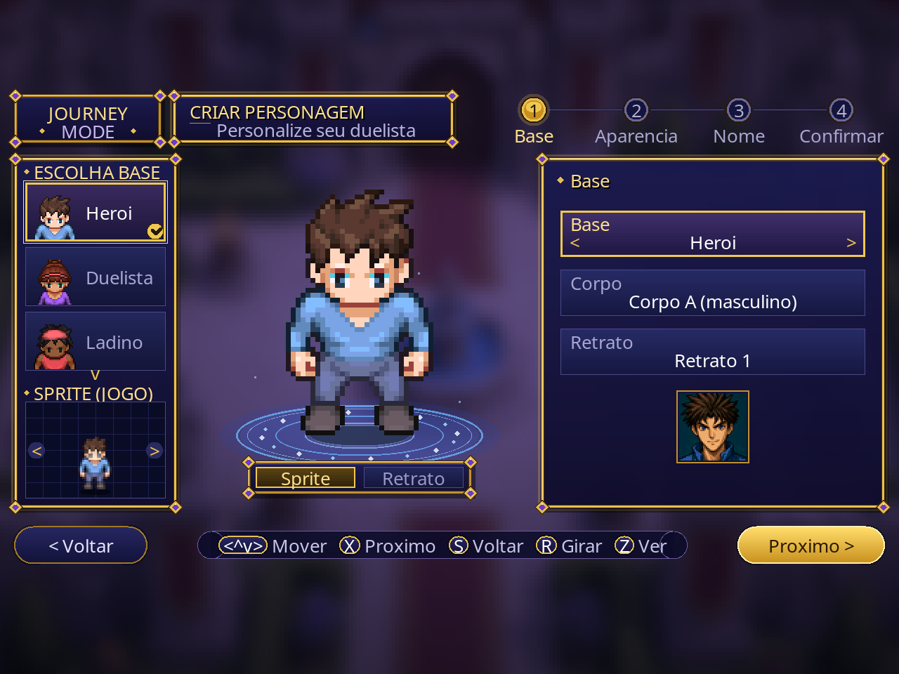
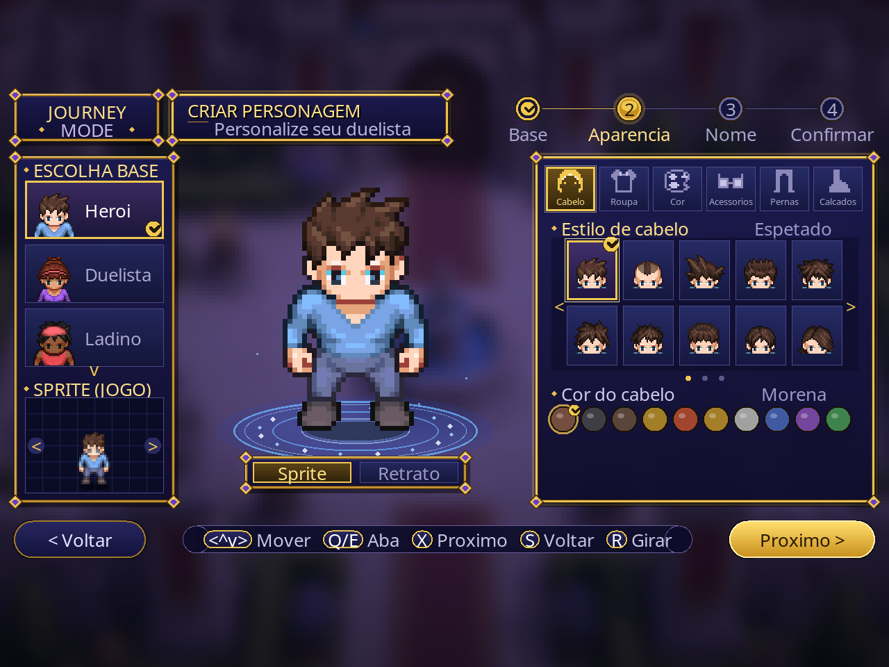
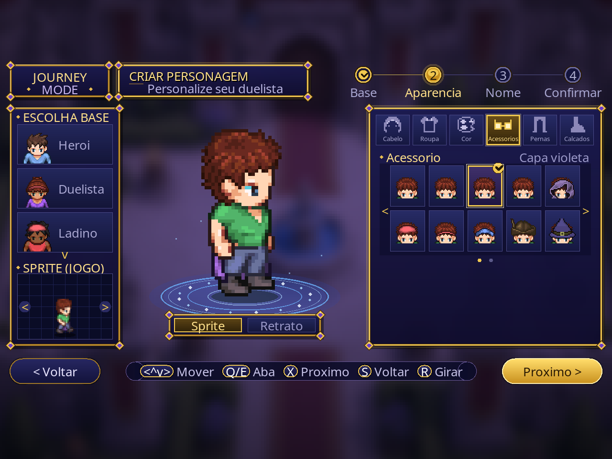
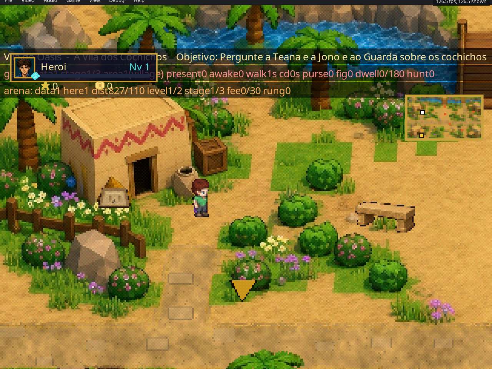
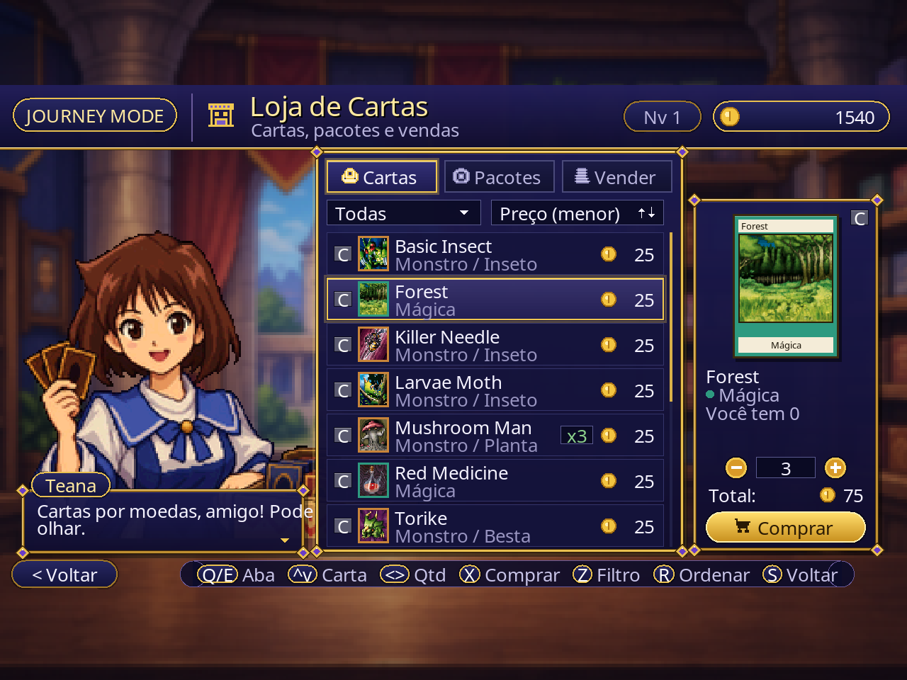
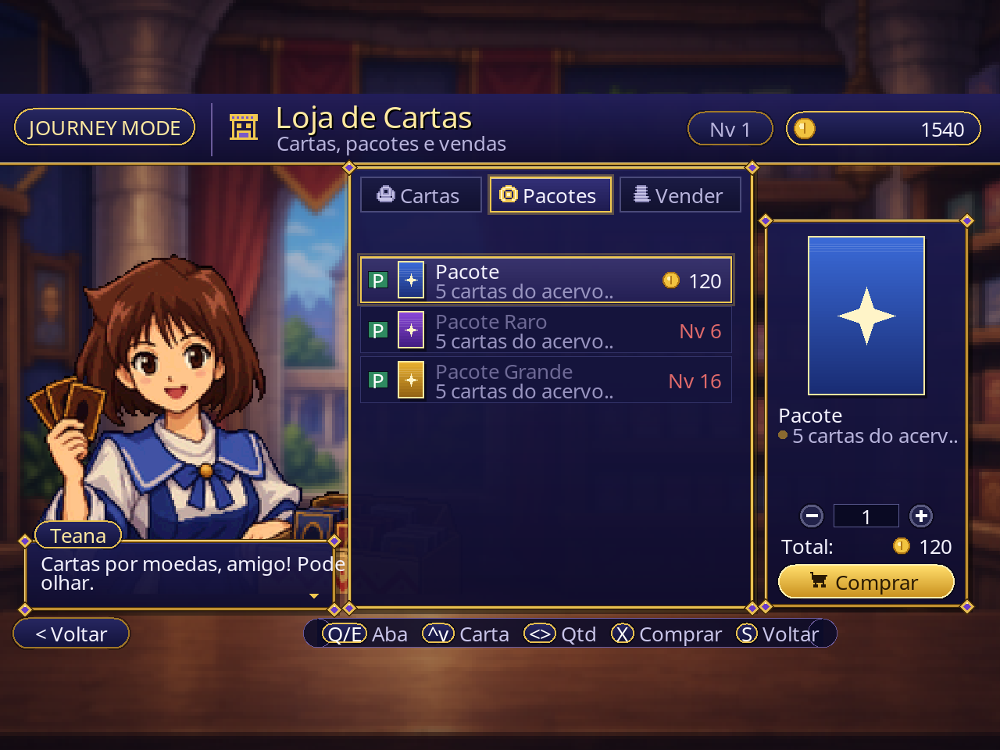
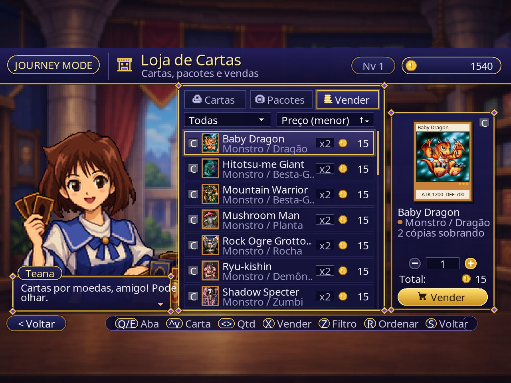
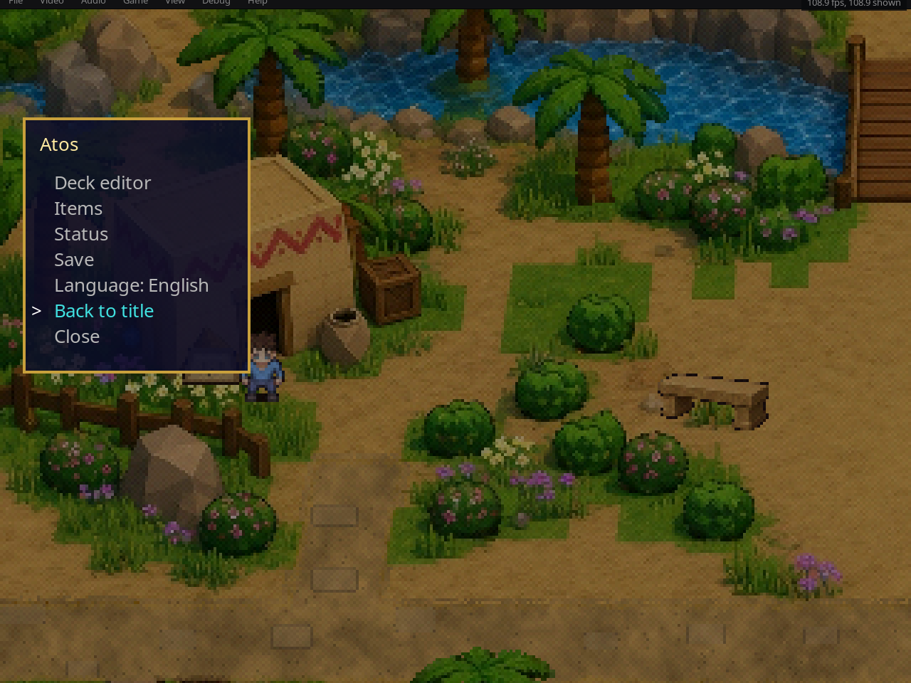

<div align="center">

# ⚔️ Journey Mode
### Um modo RPG com história para *Yu-Gi-Oh! Forbidden Memories*

Explore mapas ilustrados, converse com os duelistas do Forbidden Memories, faça missões e trave duelos de verdade com o próprio motor do jogo.

[](https://github.com/omagodev/forbidden-memories-journey-mode/releases)
[](LICENSE)


<a href="README.md"></a>


</div>

---

## O que é isso?

O Journey Mode é um projeto de fã, feito por diversão. Peguei o trabalho incrível da comunidade do Forbidden Memories, adaptei e quis criar uma **história de RPG** em cima do jogo com que cresci.

A ideia central: os duelistas da memória do jogo estão **ligados diretamente aos NPCs do mapa**. Você chega no Simon, na Teana, no Jono ou no Rex Raptor numa vila ilustrada, conversa com eles, e quando o duelo começa é o duelo de verdade do Forbidden Memories, com os decks, a IA e as fusões originais.

## Por que sprites e não 3D?

Meu objetivo inicial era um jogo que ainda rodasse num **PlayStation 1**. Comecei com mapas 3D low-poly, mas o motor gráfico do PS1 aguenta uma quantidade limitada de vértices e o resultado não me agradou.

Então troquei para **cenários ilustrados em 2D com sprites**. Eles são muito mais leves que modelos 3D, e com alguns truques (camadas, palmeiras balançando, água e fogo animados, oclusores que você atravessa por trás) dá pra fazer o jogador sentir que está num mapa bonito e rico, coisa que o 3D não permitia com aquele limite de vértices. Hoje o modo roda no port nativo para PC, mas mantém esse espírito da era PS1.

| | |
|---|---|
|  |  |
| *Missões e objetivos na vila natal* | *A arena clandestina subterrânea, iluminada por fogo animado* |

## A história

> **O Reino dos Duelistas** (em desenvolvimento)

Você é um jovem duelista da **Vila Oásis**, uma cidade tranquila no deserto onde todo mundo embaralha cartas no sol. Começam a surgir boatos sobre um torneio numa ilha distante, onde duelistas apostam **estrelas** e só os melhores chegam ao castelo.

* **Capítulo 1: a vila natal.** Prove seu valor no duelo-teste do Simon. Numa noite silenciosa, um encapuzado te entrega um Cartão de Carimbos. Ganhe três carimbos em missões criativas (algo perdido, algo vencido, algo doado), passe pela prova do porto e encare o desafio de Shadi. Conquiste o **Passe Estelar** e sua primeira estrela, igual ao Joey, e se despeça de todos no cais.
* **No navio** você conhece a Mai, aprende as regras das estrelas e esbarra no **InsetoKaiba**: um rival arrogante e obcecado por insetos, de jaleco branco e topete. Uma paródia inesquecível.
* **Capítulo 2: a Costa das Ilusões (jogável).** Desembarque na ilha, ouça as regras do Pegasus num espelho na areia, sobreviva à emboscada do Weevil com seus dados viciados e aposte suas primeiras estrelas. Antes de cada duelo de estrelas você **escolhe a aposta** (de 1 até o que você e o rival têm); a aposta perdida fica com ele até você recuperá-la. **Perdeu a última estrela, é FIM DE JOGO.**
* **Jogue o caminho longo.** O deck inicial são quarenta cartas comuns e fracas, de propósito. Ganhe cartas do conjunto local, compre na loja de cada cidade, vença a gangue dos **Chacais da Duna** ou as **arenas clandestinas**: cada arena guarda três cartas que não caem em nenhum outro lugar.
* **Capítulo 3: a Floresta dos Sussurros (jogável).** Pegue a trilha da selva até uma floresta antiga onde alguém entalha estrelas na casca das árvores. Vença um Rex Raptor perdido e furioso por uma estrela, siga as três Marcas de Estrela para abrir a clareira escondida atrás do portão de pedra e enfrente o mestre da zona, o Mago da Floresta, que põe uma estrela em jogo. A cabana do Eremita Hob e o Ringue do Tronco Oco (com três cartas que não existem em outro lugar) ajudam um baralho fraco a se recuperar.
* **Capítulo 4: a Passagem da Montanha (jogável).** A estrada da floresta sobe até um abismo com uma única ponte de corda, onde o Bandit Keith cobra o pedágio numa aposta de estrelas. Do outro lado a Mai espera para um duelo de orgulho (sem estrela), e na caverna sob a grande estrela entalhada você finalmente flagra o entalhador em ação. O Mago da Montanha guarda o portão do cume com quatro estrelas: aposte uma e suba com seis, ou arrisque mais. A Tenda do Penhasco da Cliff Cass e o Fosso da Mina (mais três cartas exclusivas de arena) ajudam, e a equipe do acampamento lembra que aqui ninguém devolve estrela.

* **O Reino (capítulos 4 a 10, roteirizados):** Passagem da Montanha, Labirinto da Campina, Deserto das Estrelas Perdidas e Feira das Estrelas. Aposte, ganhe e perca estrelas, mas cuidado: zero estrelas é fim de jogo. As estrelas são itens raros da história, nas mãos dos guardiões, e cada portão conta as que estão na sua mão: apostando o mínimo você termina o capítulo 4 com 6. Junte **10 estrelas** para abrir o portão do castelo e subir até a Sala dos Sonhos do Pegasus.
* **Mago.dev, o observador.** Um mago que *programa a realidade*, mas nunca interfere. Você vai vê-lo de relance em telhados, em runas verdes na parede de uma cisterna, no alto de um mastro... até o final.

O roteiro completo está em [`journey_content/duelist_kingdom/`](journey_content/duelist_kingdom/README.md), e todos os diálogos em ordem de leitura estão em [português](journey_content/duelist_kingdom/pt/story_readable_dk.pt.md) e [inglês](journey_content/duelist_kingdom/en/story_readable_dk.en.md). Com spoilers, claro.

## Criação de personagem

Antes da jornada você monta seu próprio duelista, e o herói que anda pelo mapa é exatamente o que você criou, quadro a quadro (1 parado + 9 de caminhada). Cada parte é uma camada real de sprite LPC montada em tempo real.

| Parte | Variações |
|---|---|
| Bases iniciais | **6**: Herói, Duelista, Ladino, Místico, Estudioso, Patrulheiro |
| Tons de pele | **6** |
| Tipos de corpo | **2** |
| Cabelos | **21**, cada um em **10** cores |
| Roupas | **11**, cada uma em **10** cores |
| Calças | **10** |
| Calçados | **7** |
| Acessórios | **13** (capas, chapéus, óculos e mais) |

São mais de **250 milhões** de combinações possíveis (6 × 2 × 21 × 10 × 11 × 10 × 10 × 7 × 13). Alguns exemplos: escolha a base **Ladino**, dê cabelo longo branco e uma túnica vermelha, e você tem um ladrão de cartas andarilho; pegue o **Místico**, troque para pele escura, cabelo roxo e uma capa, e nasce um feiticeiro do deserto; ou comece pelo **Estudioso**, com óculos e colete verde, para um pesquisador de cartas tranquilo.

<div align="center">

**Escolha a base**



**Escolha cabelo e cor**



**Adicione acessórios**



**Seu herói andando no jogo**



</div>

## Loja de cartas

Toda cidade tem uma loja da Teana: compre cartas avulsas com a arte real do jogo, abra pacotes ou venda suas cópias repetidas. Preços, níveis e estoque vêm do sistema de economia.

<div align="center">

**Aba Cartas**



**Aba Pacotes**



**Aba Vender**



</div>

## Funcionalidades

- 🗺️ **Mapas ilustrados:** vila natal, cisterna e arena subterrânea, com água, fogo e palmeiras animados
- 🧑‍🤝‍🧑 **NPCs ligados aos duelistas do Forbidden Memories:** converse, faça missões e duele com o motor original
- 🎭 **Criador de personagem** montado em camadas (corpo, roupa, cabelo, acessório)
- 📜 **Missões, objetivos e diário**, com seta de objetivo e minimapa
- 💰 **Economia (inicial):** dinheiro, uma loja em cada cidade e drop só das cartas locais
- 🥷 **Gangue de duelistas (inicial):** te abordam com uma certa frequência, você não pode fugir, e se eles ganham levam seu dinheiro
- 🔥 **Arenas clandestinas (inicial):** farme cartas locais e suba de nível
- 🌐 **Inglês e português**

<div align="center">



*O menu Start dentro do jogo: editor de deck, mochila, status, salvar e idioma. A Mochila guarda os itens da história (cada um com seu ícone) e as cartas que a história te deu; X abre os detalhes.*

</div>

## Como jogar

> 📥 **Não precisa compilar.** Baixe a versão para Windows [**JourneyMode_v0.6.0-alpha_Windows.zip**](https://github.com/omagodev/forbidden-memories-journey-mode/releases/download/v0.6.0-alpha/JourneyMode_v0.6.0-alpha_Windows.zip) em [Releases](https://github.com/omagodev/forbidden-memories-journey-mode/releases/latest). Guia completo: [docs/HOW_TO_PLAY.pt-BR.md](docs/HOW_TO_PLAY.pt-BR.md).

1. Baixe a versão mais recente em [**Releases**](https://github.com/omagodev/forbidden-memories-journey-mode/releases) e extraia.
2. Copie seu `.bin` para a pasta `game` e rode `JOGAR_JourneyMode.bat` (ou `memories-pc.exe`).
3. Na primeira vez, escolha **a sua própria** imagem do disco americano (`SLUS-01411`, `.bin`). **Nenhum dado do jogo vem incluso.**
4. Na tela de título, escolha **NOVO JOGO** para criar seu personagem.

## Compilar e contribuir

Tudo o que você precisa para configurar, compilar e testar está em [**docs/CONTINUE_DEVELOPMENT.pt-BR.md**](docs/CONTINUE_DEVELOPMENT.pt-BR.md). A versão curta:

```sh
./build-pc.sh                                         # compila o port
python3 tools/pc/build_mod.py --target i386 mods/ow-poc   # compila o Journey Mode
```

| Pasta | O que tem dentro |
|---|---|
| [`mods/ow-poc/`](mods/ow-poc) | O mod Journey Mode: código C, mapas e sprites convertidos, ferramentas |
| [`journey_content/`](journey_content) | História, decks, economia e textos da interface (EN/PT) com validadores |
| [`art_dk/`](art_dk) | Fontes de arte e pipelines de conversão |
| [`docs/`](docs) | Guia de continuação, testes e [a documentação do port nativo](docs/PORT.pt-BR.md) |

Ideias, bugs e pull requests são muito bem-vindos: veja o [CONTRIBUTING.pt-BR.md](CONTRIBUTING.pt-BR.md) e o [roadmap](ROADMAP.pt-BR.md).

## Roadmap

Os destaques (lista completa no [ROADMAP.pt-BR.md](ROADMAP.pt-BR.md)):

- [x] Vila natal ilustrada, NPCs, diálogos, missões e capítulo 1
- [x] Criador de personagem com sprites em camadas
- [x] Arena subterrânea com fogo animado
- [ ] Economia, gangue e arenas: balanceamento e polimento
- [x] Porto, convés do navio e Costa das Ilusões ilustrados; capítulo 2 jogável
- [x] Floresta dos Sussurros ilustrada; capítulo 3 jogável
- [x] Passagem da Montanha ilustrada; capítulo 4 jogável
- [x] Deck inicial fraco e cartas exclusivas das arenas
- [ ] Capítulos 3 a 10 do Reino dos Duelistas
- [ ] Mais zonas ilustradas da ilha
- [ ] 🌐 **Multiplayer online**: duele com seus amigos direto do mapa

## Nos ombros de gigantes

Este projeto não existiria sem:

- **[Yu-Gi-Oh! Forbidden Memories Recompiled](https://github.com/Unchiga/Yu-Gi-Oh-Forbidden-Memories-Recompiled)**, de Unchiga e colaboradores: o port nativo para PC, o renderizador e o carregador de mods sobre os quais tudo aqui roda. Vá apoiá-los.
- **[memories-decomp](https://github.com/krystalgamer/memories-decomp)**, de krystalgamer e seus autores: a descompilação por trás do port.
- Os artistas do **[Liberated Pixel Cup](https://github.com/LiberatedPixelCup/Universal-LPC-Spritesheet-Character-Generator)**, **Kenney** e **Quaternius**, entre outros.

A lista completa, com licenças, está no [CREDITS.pt-BR.md](CREDITS.pt-BR.md).

## Licença

O código e o conteúdo do Journey Mode estão sob a licença [MIT](LICENSE), © Atos Vinicius ([omagodev](https://github.com/omagodev)). O port é MIT, de seus autores. A arte de terceiros mantém sua própria licença (veja o [CREDITS.pt-BR.md](CREDITS.pt-BR.md)).

*Yu-Gi-Oh! e Forbidden Memories pertencem a Kazuki Takahashi e à Konami. Este é um projeto de fã, não oficial e sem fins comerciais, sem nenhuma ligação com a Konami.*
