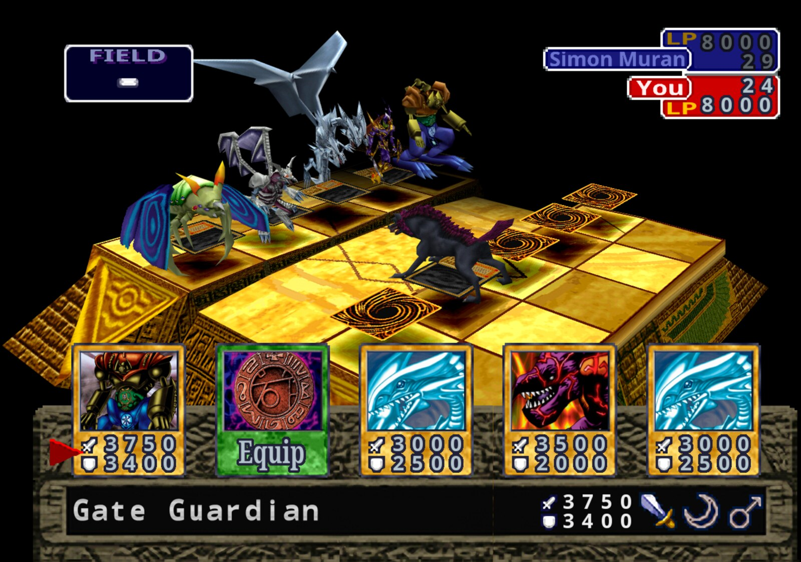
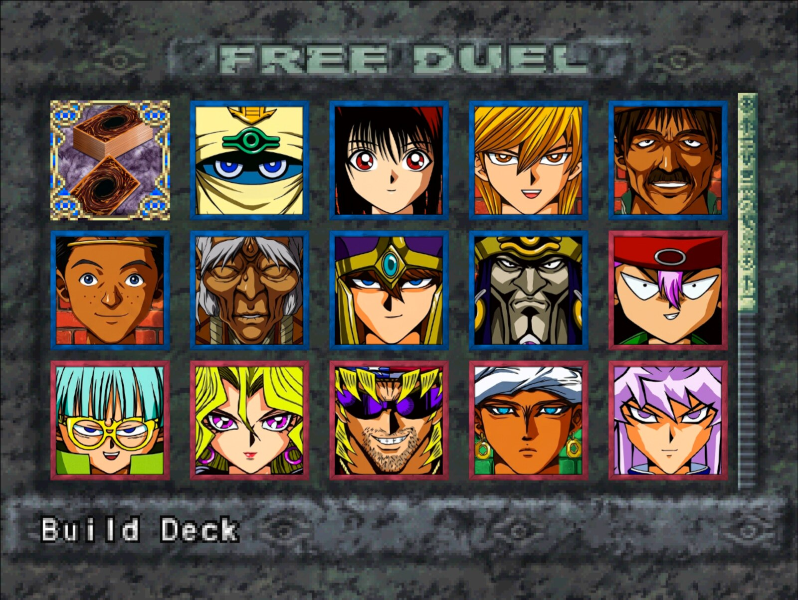

<p align="right"><a href="PORT.md"></a></p>

# O port nativo (upstream)

O Journey Mode roda sobre o [Yu-Gi-Oh! Forbidden Memories Recompiled](https://github.com/Unchiga/Yu-Gi-Oh-Forbidden-Memories-Recompiled). Esta página guarda a documentação do próprio port como foi importada, para que o README principal possa focar no Journey Mode.

**Yu-Gi-Oh! Forbidden Memories** (PS1, EUA) reconstruído a partir do código-fonte descompilado como um
jogo nativo de PC para Windows e Linux, com compilação a partir do código para macOS ARM64. Traga sua própria imagem de disco; nenhum dado do jogo
vem incluso, exceto o texto das traduções europeias (abaixo).

Isto não é uma recompilação estática: o código do jogo foi descompilado
à mão para um C que bate byte a byte com o original e depois portado para PC.



## Funcionalidades

- Resolução interna de até 4x, widescreen e texto HD
- **Monstros 3D**: monstros com a face para cima ficam no campo como seus modelos de batalha
- Pacote opcional **Forbidden Memories HD**: cartas, molduras e retratos redesenhados
- Mods: estrutura para novas cartas além das 722 originais, fusões, texturas, música, tabelas de jogabilidade
- **FM Editor**: crie mods sem escrever JSON: cartas, arte, fusões, duelistas, decks, pacotes, a tela de título e mais ([guia](../tools/pc/fm_editor/README.md))
- Slots de save, ajudante de fusões, taxas de drop de cartas, controles reconfiguráveis
- **Game > Language**: o inglês, francês, alemão, italiano e espanhol das próprias versões europeias



## Como jogar

Baixe a versão mais recente em [Releases](https://github.com/omagodev/forbidden-memories-journey-mode/releases),
extraia e rode `memories-pc.exe` (Windows) ou `./memories-pc` (Linux). Na primeira
vez, escolha o `.bin` do seu disco americano. O jogo pode avisar quando sair uma versão nova
(**Help > Check for updates at start** desliga isso; veja [Atualizações](../notes/updates.md)).

### Traga seu save de um emulador

Seu save do jogo original (o memory card de um emulador, ou um cartão de PS1 copiado para o PC)
carrega no port. Copie o arquivo do memory card (`.mcr`, `.mcd`, `.srm`, `.gme`, `.mcs`, `.psv`,
...; o DuckStation guarda os cartões na pasta `memcards`, o ePSXe em `memcards`) para a
pasta `saves` do port: `Documents\My Games\YFM Re-Decomp\saves` no Windows,
`~/.local/share/YFM Re-Decomp/saves` no Linux. Depois escolha **LOAD** na tela de título: o
save é copiado para um slot vazio (o arquivo do cartão é renomeado para `.imported`) e você pode carregá-lo.
Save states de emulador não são memory cards e não podem ser importados; salve dentro do jogo antes.

### Pacote HD

1. Na mesma release, baixe `yfm-redecomp-hd-mod-<versão>.zip`.
2. Feche o jogo e extraia o zip na pasta do jogo, a que tem `memories-pc.exe`
   ou `memories-pc`. Deve ficar uma pasta `mods/assets-hd` ao lado dos outros mods.
3. Abra o jogo. O pacote vem ligado por padrão: aperte **F10** para a barra de menu e abra
   **Game > Mods** para conferir, ou para desligar o pacote ou qualquer parte dele.
4. Para o melhor visual, escolha **Video > Resolution > Internal 4x** e ligue **Video > HD text**.

**A partir do código-fonte:** coloque o `.bin` em `game/` e rode `play.bat` ou `./play.sh`. A primeira
execução compila tudo (no Linux precisa de `gcc` e `python3`). Veja [Compilação para PC](../notes/pc-build.md).

No Apple Silicon, `./play.sh` compila e roda a versão macOS usando Python 3,
as ferramentas de linha de comando do Xcode e dependências verificadas instaladas em `tmp/`.
Veja [Compilação no macOS](../notes/macos-build.md) e o [guia do runtime ARM64](../notes/macos-arm64.md).
Os save states nativos usam F5/F7 e têm limites de compatibilidade de versão e plataforma;
veja [compatibilidade de save states](../notes/macos-arm64.md#save-state-use-and-compatibility). Mods de código
precisam de uma compilação macOS ARM64; binários de mods de código i386 existentes não podem ser carregados.
Veja [mods de código no macOS](../notes/modding.md#native-macos-arm64-code-mods).

**Idiomas:** `languages/*.txt` é o texto das cinco versões europeias, lido dos
discos PAL pelo próprio port. Com os discos em `game/pal`, `python3 tools/pc/export_languages.py`
gera os arquivos de novo, e `--check` compara ([Traduções](../notes/translation.md),
"The official languages"). Eles são os únicos dados do jogo no repositório: texto, nenhuma imagem.

## Descompilação

Cada função do jogo bate byte a byte com o executável original:

```sh
make tools   # toolchain fixada
make match   # recompila o SLUS_014.11 exatamente (veja notes/setup.md)
```

<details>
<summary>Progresso</summary>

<!-- BEGIN GENERATED PROGRESS -->

| Metric | Current |
|---|---:|
| Game C-decompilation targets matched | **1,134 / 1,134 (100.00%)** |
| Game C-decompilation target bytes matched | **356,080 (`0x56EF0`) / 356,080 (`0x56EF0`) (100.00%)** |
| Remaining game C-decompilation targets | 0 functions, 0 (`0x0`) |
| Evidence-backed handwritten game assembly | 61 functions, 40,116 (`0x9CB4`) |
| Total game-owned functions | 1,195 |
| Preserved Psy-Q CRT/SDK assembly | 591 functions, 117,348 (`0x1CA64`) |
| Total discovered functions | 1,786 |
| Embedded/unassigned resident text | 1,780 (`0x6F4`) |

Runtime overlay modules:

| Module | Matching C functions | Matching C bytes |
|---|---:|---:|
| `free_duel` | 9 / 9 (100.00%) | 4,140 (`0x102C`) / 4,140 (`0x102C`) (100.00%) |
| `main_menu` | 31 / 31 (100.00%) | 17,724 (`0x453C`) / 17,724 (`0x453C`) (100.00%) |
| `overworld_after_coup` | 15 / 15 (100.00%) | 6,184 (`0x1828`) / 6,184 (`0x1828`) (100.00%) |
| `overworld_before_coup` | 15 / 15 (100.00%) | 6,184 (`0x1828`) / 6,184 (`0x1828`) (100.00%) |
| `password` | 27 / 27 (100.00%) | 10,884 (`0x2A84`) / 10,884 (`0x2A84`) (100.00%) |

_Generated from `config/slus_01411/functions.csv` and `config/slus_01411/overlays/*_functions.csv` by `tools/project/progress.py`._

<!-- END GENERATED PROGRESS -->

</details>

## Documentação

[Modding](../notes/modding.md) · [FM Editor](../tools/pc/fm_editor/README.md) · [Mais cartas](../notes/more-cards.md) · [Ajudante de fusões](../notes/fusion-helper.md) ·
[Drops de cartas](../notes/card-drops.md) · [Pacotes de cartas](../notes/card-packs.md) · [Traduções](../notes/translation.md) · [Atualizações](../notes/updates.md) · [Configuração](../notes/setup.md) · [Compilação](../notes/build.md) ·
[Releases](../notes/pc-release.md)

*Os documentos de `notes/` estão em inglês.*
